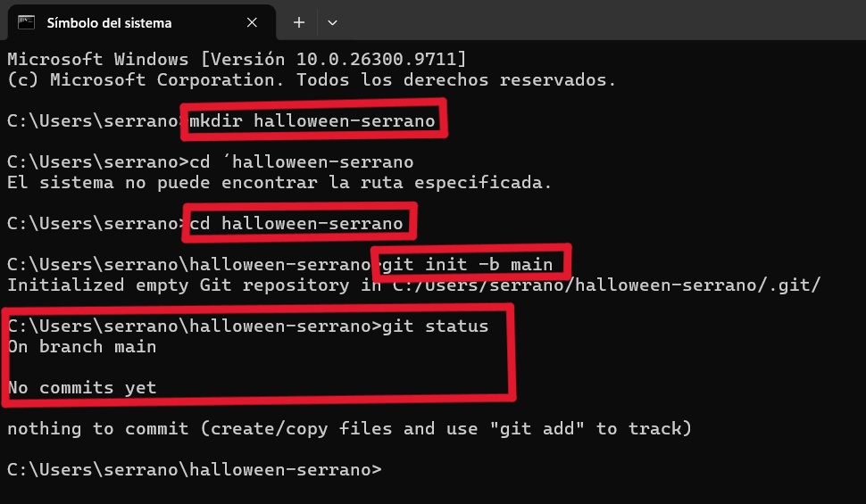
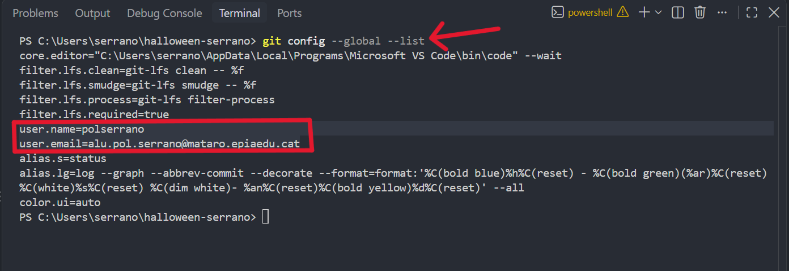
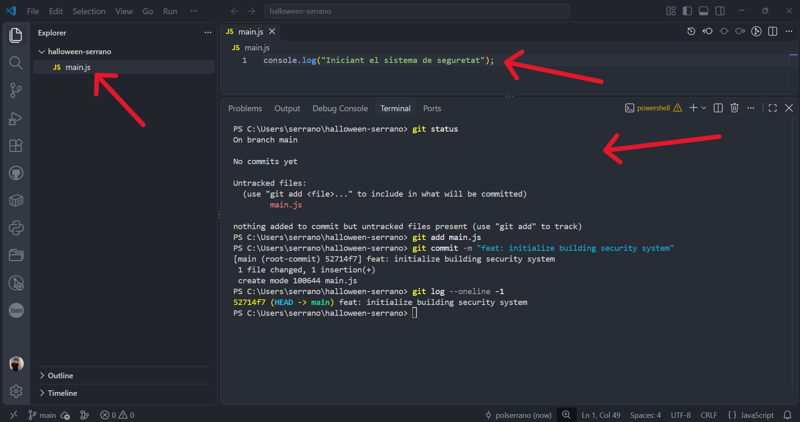
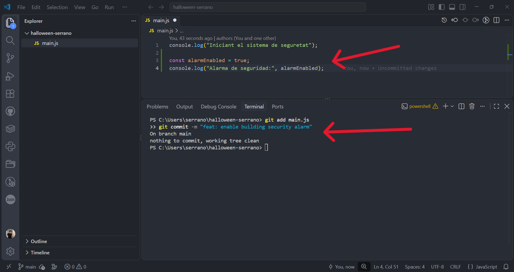
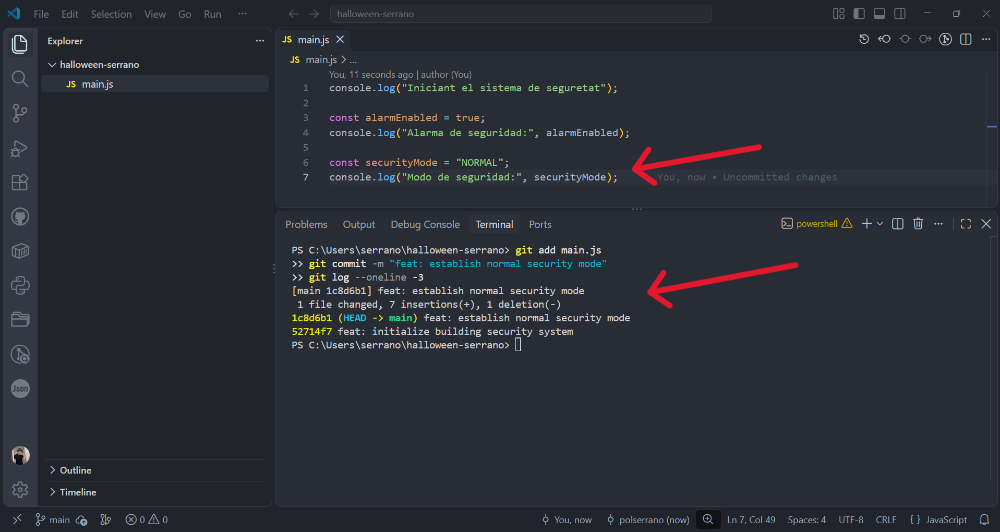

# Bloc 1: Invocació del Repositori i Línia Base

## Acció 3.1 — Creació del repositori local

En aquest primer pas, creem l'estructura de carpetes necessària per al nostre projecte de seguretat.
Accedim al directori creat i inicialitzem un nou repositori local de Git, establint la branca
principal amb el nom `main`. Finalment, comprovem que l'estat inicial del directori de treball
estigui completament net abans de començar a afegir codi.

```bash
mkdir halloween-serrano
cd halloween-serrano
git init -b main
git status
```

**Evidència — Captura 1**



---

## Acció 3.2 — Configuració de la identitat

Abans de registrar qualsevol canvi al repositori, és indispensable configurar la identitat de l'autor.
Això garanteix que tots els commits futurs quedin correctament associats al nom i correu de l'estudiant.
Verifiquem la configuració global del sistema per comprovar que les credencials del perfil
siguin les adients i estiguin ben registrades.

```bash
git config --global --list
```

**Evidència — Captura 2**



---

## Acció 3.3 — Primer commit (Sistema de Seguretat)

Creem el fitxer principal del projecte anomenat `main.js` amb el codi base del sistema de seguretat.
A continuació, afegim el fitxer a l'àrea de preparació (*staging area*) mitjançant la comanda `git add`.
Registrem el primer commit (*root-commit*) amb un missatge descriptiu seguint la convenció `feat`.
Per acabar, utilitzem `git log` per confirmar que el commit s'ha creat correctament amb el seu hash.

```bash
git add main.js
git commit -m "feat: initialize building security system"
git log --oneline -1
```

**Evidència — Captura 3**



---

## Acció 3.4 — Segon commit (Activació de l'Alarma)

El desenvolupament del sistema continua afegint una nova funcionalitat per a l'alarma de seguretat.
Editem el fitxer `main.js` per incloure la variable i el missatge corresponent a l'alarma.
Tornem a afegir el fitxer modificat a l'àrea de preparació per indicar a Git quins canvis volem desar.
Finalment, fem el segon commit per registrar aquest increment de codi a l'historial del projecte.

```bash
git add main.js
git commit -m "feat: enable building security alarm"
```

**Evidència — Captura 4**



---

## Acció 3.5 — Tercer commit i verificació de l'historial

Completem la línia base del sistema definint el mode de seguretat inicial com a `NORMAL`.
Afegim els canvis realitzats a `main.js` i creem el tercer commit corresponent a la branca principal.
Consultem l'historial recent de commits amb `git log` per comprovar la seqüència cronològica dels canvis.
Confirmem amb `git status` que el directori de treball està completament net i a punt per al següent bloc.

```bash
git add main.js
git commit -m "feat: establish normal security mode"
git log --oneline -3
```

**Evidència — Captura 5**

