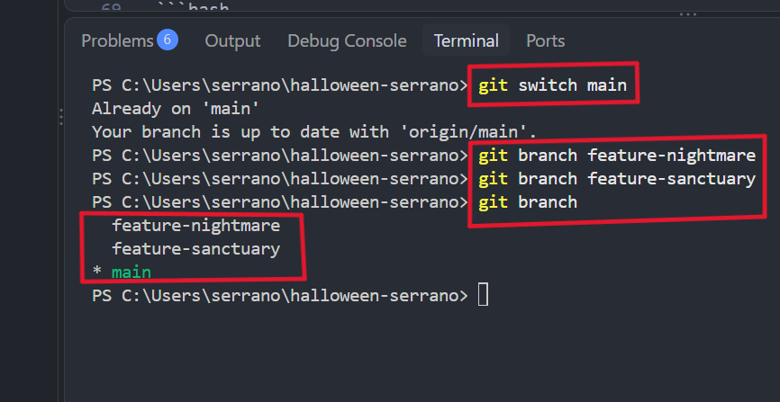
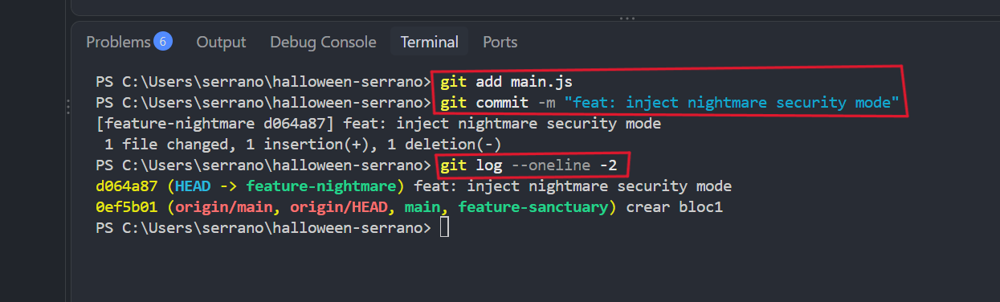
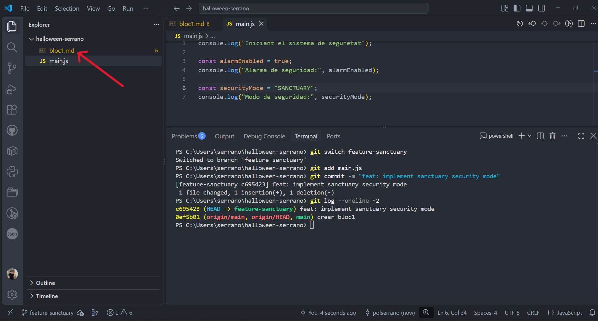
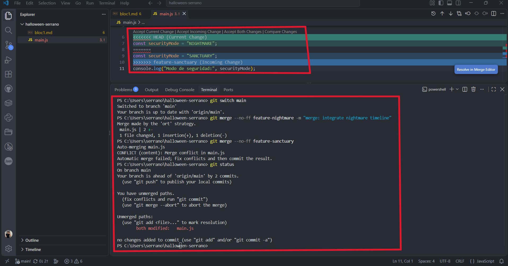
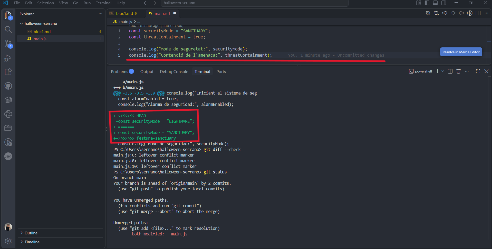
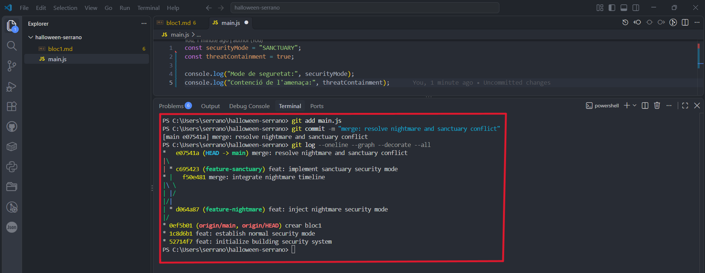

# Bloc 2: Les Branques del Més Enllà i Resolució del Conflicte

## Acció 3.6 — Creació de branques paral·leles

Per desenvolupar noves funcionalitats de manera aïllada, ens assegurem d'estar a la branca `main`.
Creem dues branques noves a partir d'aquesta línia base: `feature-nightmare` i `feature-sanctuary`.
Aquesta estructura ens permetrà treballar en diferents alternatives de seguretat en paral·lel.
Verifiquem la llista de branques disponibles al repositori local per confirmar que s'han creat bé.

```bash
git switch main
git branch feature-nightmare
git branch feature-sanctuary
git branch
```

**Evidència — Captura 7**



---

## Acció 3.7 — Desenvolupament a la branca nightmare

Ens traslladem a la branca `feature-nightmare` utilitzant la comanda `git switch`.
Modifiquem el fitxer `main.js` per canviar el mode de seguretat del sistema a `NIGHTMARE`.
Afegim el fitxer modificat a l'àrea de preparació i enregistrem el canvi amb un commit propi.
Comprovem amb `git log` que aquest commit només existeix a la línia temporal d'aquesta branca.

```bash
git switch feature-nightmare
git add main.js
git commit -m "feat: inject nightmare security mode"
git log --oneline -2
```

**Evidència — Captura 9**



---

## Acció 3.8 — Desenvolupament a la branca sanctuary

Canviem a la branca `feature-sanctuary` per desenvolupar una alternativa de protecció diferent.
En aquesta branca, modifiquem la mateixa línia de codi per establir el mode de seguretat com a `SANCTUARY`.
Guardem els canvis, els afegim a l'àrea de preparació i fem el commit corresponent.
Verifiquem l'historial de la branca per confirmar que el desenvolupament ha quedat registrat independentment.

```bash
git switch feature-sanctuary
git add main.js
git commit -m "feat: implement sanctuary security mode"
git log --oneline -2
```

**Evidència — Captura 10**



---

## Acció 3.9 — Integració i detecció del conflicte

Retornem a la branca `main` i fusionem primer la branca `feature-nightmare` sense cap problema.
En intentar fusionar la branca `feature-sanctuary`, Git detecta canvis incompatibles a la mateixa línia.
Això genera un conflicte de fusió (*merge conflict*) automàtic que atura el procés d'integració.
Executem `git status` per confirmar quins fitxers tenen modificacions en conflicte pendents de resoldre.

```bash
git switch main
git merge --no-ff feature-nightmare -m "merge: integrate nightmare timeline"
git merge --no-ff feature-sanctuary
git status
```

**Evidència — Captura 11**



---

## Acció 3.10 — Resolució manual del conflicte i fusió

Usem `git diff --check` per identificar les marques de conflicte (`<<<<<<<`, `=======`, `>>>>>>>`).
Editem manualment el fitxer `main.js`, seleccionant el mode `SANCTUARY` i afegint la contenció de l'amenaça.
Un cop resolt el codi, afegim el fitxer a *staging* i completem el commit de fusió (*merge commit*).
Anotem l'arbre visual del repositori amb `git log --graph` per confirmar la unió de les branques.

```bash
git diff --check
git status
git add main.js
git commit -m "merge: resolve nightmare and sanctuary conflict"
git log --oneline --graph --decorate --all
```

**Evidència — Captures 12 i 13**



