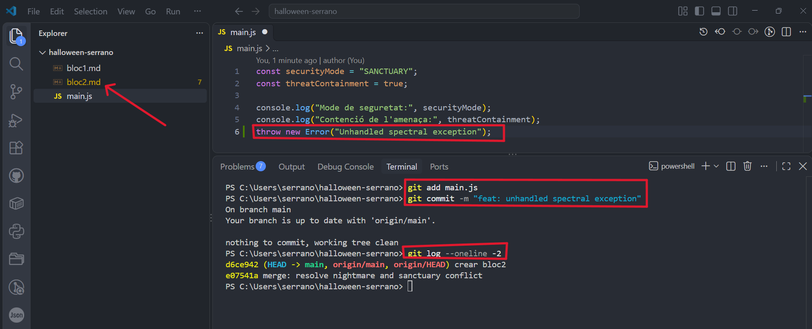
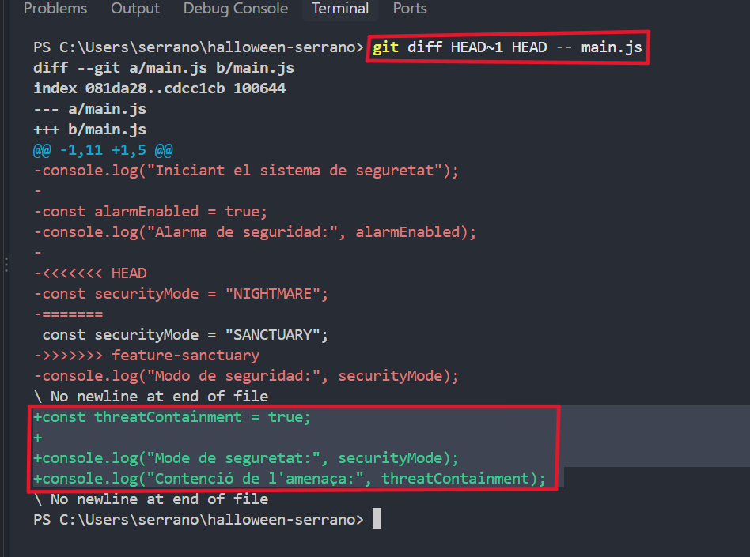
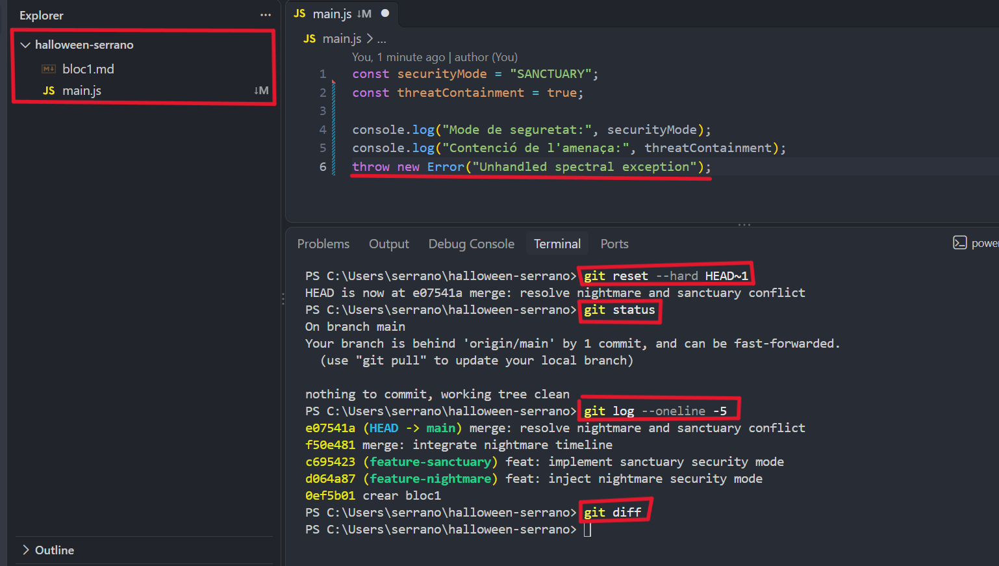
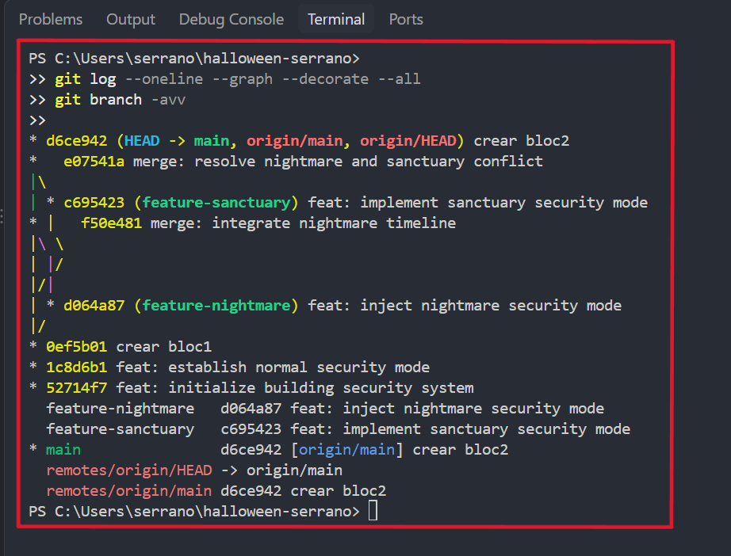
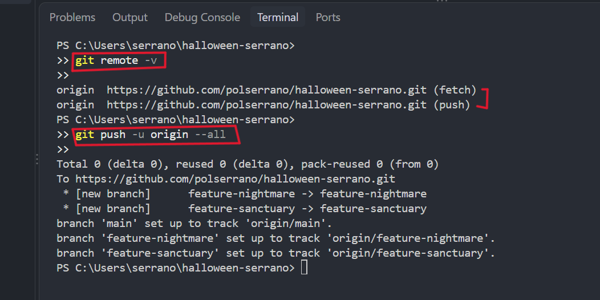

# Bloc 3: Viatge Temporal, Exorcisme del Codi i Publicació Remota

## Acció 3.11 — Creació del commit infectat

Simulem una fallada crítica en el sistema introduint un error intencionat (`throw new Error`) a `main.js`.
Aquesta modificació representa una injecció de codi maliciós o espectral dins del nostre projecte.
Afegim el fitxer corromput a l'àrea de preparació i registrem el commit amb el missatge d'error.
Així deixem constància de l'estat infectat en l'historial recent de la branca principal.

```bash
git add main.js
git commit -m "feat: unhandled spectral exception"
```

**Evidència — Captura 14**



---

## Acció 3.12 — Inspecció de les diferències

Abans de prendre mesures per corregir l'error, analitzem exactament quins canvis s'han fet.
Utilitzam la comanda `git diff` comparant el commit infectat (`HEAD`) amb el commit anterior (`HEAD~1`).
Aquesta inspecció ens permet aïllar la línia exacta que ha causat la fallada en el fitxer `main.js`.
Gràcies a aquest diagnòstic, podem determinar quina és la millor estratègia de recuperació.

```bash
git diff HEAD~1 HEAD -- main.js
```

**Evidència — Captura 15**



---

## Acció 3.13 — Recuperació de l'estat segur (Exorcisme)

Per eliminar completament l'error, utilitzem `git reset --hard HEAD~1` per retrocedir un commit en el temps.
Aquesta opció descarta tant el commit maliciós com qualsevol canvi present al directori de treball.
Comprovem amb `git status` i `git log` que el repositori ha retornat a l'estat segur anterior.
Verifiquem amb `git diff` que no queda cap rastre del codi infectat i que el sistema torna a ser estable.

```bash
git reset --hard HEAD~1
git status
git log --oneline -5
git diff
```

**Evidència — Captura 16**



---

## Acció 3.14 — Inspecció gràfica de la topologia

Després de la recuperació, analitzem l'estructura completa del repositori per verificar la seva integritat.
Executem `git log --graph` per visualitzar el mapa de branques, unions i commits realitzats.
Utilitzem `git branch -avv` per comprovar l'estat de totes les branques locals i les seves referències.
Confirmem que la línia principal és neta i que totes les branques estan correctament organitzades.

```bash
git log --oneline --graph --decorate --all
git branch -avv
```

**Evidència — Captura 19**



---

## Acció 3.15 — Publicació a GitHub

Per finalitzar el projecte, vinculem el repositori local amb el servidor remot a GitHub (`halloween-serrano`).
Comprovem amb `git remote -v` que les adreces de depòsit remot s'hagin configurat correctament.
Pugem totes les branques locals al repositori remot mitjançant la comanda `git push -u origin --all`.
Proporcionem l'enllaç públic del repositori per permetre la revisió i auditoria final del treball.

```bash
git remote -v
git push -u origin --all
```

**Evidència — Captura 20**



**Enllaç al repositori públic:** [halloween-serrano](https://github.com/polserrano/halloween-serrano)